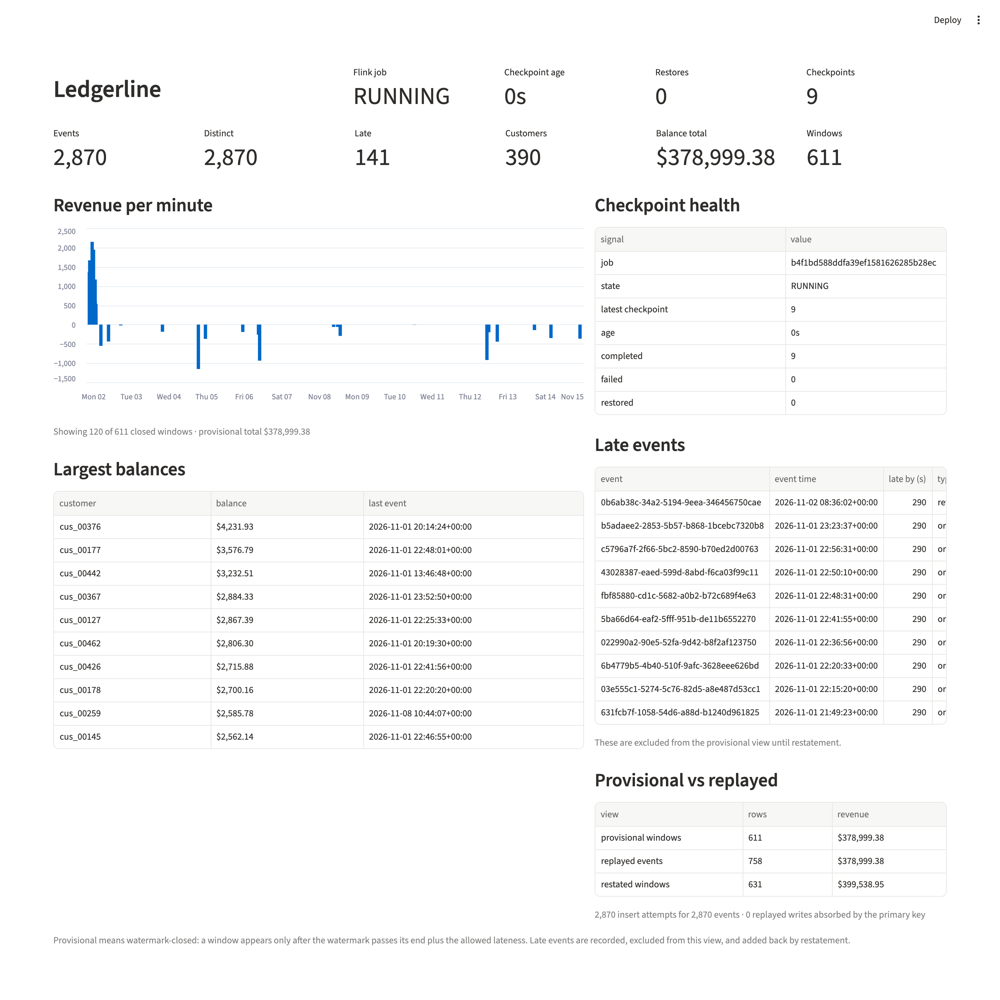

# ledgerline-stream

The real-time half of **Ledgerline**: Kafka → Flink → Postgres → Streamlit.

`ledgerline-batch` owns the same events on a daily cadence and is the
authoritative ledger. This repository processes them as they arrive and keeps a
**provisional** view: watermark-closed, restatable, and honest about what it
does not yet know. Same deterministic generator, same event IDs, so the two
paths reconcile against one ground truth.

```
eventforge ──► Kafka (ledger.events)
                  │
            Flink 1.20, event time
                  ├─ ledger_events        every raw event, ON CONFLICT DO NOTHING
                  ├─ late detector ──────► late_events (side output)
                  └─ money events
                       ├─ keyBy(customer), ValueState in RocksDB ──► customer_balances
                       └─ 1-minute tumbling window + 30 s lateness ─► revenue_windows
                                                                        │
                                                          reconciliation ──► restatement
                                                                        │
                                                                   Streamlit
```

## What it demonstrates

| Requirement | Where |
|---|---|
| Exactly-once (at-least-once + idempotent sink) | `demo/exactly_once.py`, ADR-0003 in `ledgerline-batch` |
| Event-time watermarks, allowed lateness | `LedgerJob`, `LateDetector`, [ADR-0005](docs/adr/0005-late-data-side-output-and-restatement.md) |
| Late-data side output + restatement | `late_events`, `reconciliation --restate`, `demo/late_data.py` |
| RocksDB state + checkpoints + restore | `LedgerJob`, [ADR-0004](docs/adr/0004-rocksdb-incremental-checkpoints.md) |
| Live dashboard | `dashboard/app.py` |
| Deterministic replay | [docs/replay-determinism.md](docs/replay-determinism.md) |
| Ground-truth reconciliation | `reconciliation/reconcile.py` |



*Late-data run: 141 events missed their window, the provisional total is
37,899,938 cents, and the checkpoint counter is live.*

## Stack (free path)

No Docker, no billing account. Everything runs from tarballs into
`~/.local/ledgerline-stream`:

| Component | Version | Notes |
|---|---|---|
| Kafka | 3.9.1, KRaft | single broker, single-partition topic by default |
| Flink | 1.20.3 LTS | JobManager + 2 TaskManagers, 4 slots |
| Postgres | 16.2 | bundled `pgserver` on `127.0.0.1:5433` |
| JDK / Maven | 17.0.21 / 3.10.0 | |
| eventforge | editable from `../ledgerline-batch` | deterministic UUIDv5 IDs |

Checkpoints go to `file://…/.checkpoints` instead of S3/MinIO, and Terraform
state is local. Both are deliberate free-path substitutions, recorded in the
batch repo's `infra/README.md`.

## Quickstart

```bash
make install          # uv sync
make stack-up         # Postgres, Kafka, Flink
make replay           # reset, submit, produce, flush, reconcile
make dashboard        # http://127.0.0.1:8501
```

`make replay` is the one-command demo. It resets the topic to one partition,
submits the job, produces the ordered day, sends the end-of-replay marker, and
reconciles against `eventforge`.

If `make` is unavailable (it needs the Xcode command-line tools on this
machine), the same targets are plain modules:

```bash
uv run python -m stack.postgres up
uv run python -m stack.kafka up
uv run python -m stack.cluster up

uv run python -m demo.reset
uv run python -m stack.cluster submit
uv run eventforge kafka --seed 42 --start 2026-11-01 --days 1 \
  --bootstrap 127.0.0.1:9092 --topic ledger.events --rate 600 --sort
uv run python -m stack.kafka flush
uv run python -m reconciliation.reconcile --days 1
```

The deterministic day (seed 42, 2026-11-01, 800 orders) is **2,870 events /
396 customers / 39,953,895 cents**, max event time `2026-11-14 21:16:02`
(refunds trail their orders by up to two weeks).

## The two demos

### Exactly-once: kill a TaskManager mid-replay

```bash
make demo-exactly-once
```

The script waits for a checkpoint, kills the busy TaskManager with `SIGKILL`,
waits for the job to restore, finishes the replay, flushes, and reconciles.

Measured run (`evidence/exactly-once-20261109T170920Z.json`):

| Signal | Observed |
|---|---|
| Restore time | 21.3 s |
| Checkpoints restored | 1 |
| Events | 2,870 distinct, 0 duplicates |
| Insert attempts | 3,052 for 2,870 events |
| Replayed writes absorbed | 182 |
| Balance / window total | 39,953,895 cents (both) |

A `BEFORE INSERT` trigger counts every attempt, including the ones
`ON CONFLICT DO NOTHING` skips. Without it, an idempotent sink after a failover
looks exactly like a sink that never replayed anything. This is
**effectively-once**: delivery is at-least-once, and each side effect is
idempotent on `event_id`.

### Late data: provisional view, then restatement

```bash
make demo-late-data
```

5% of events are re-stamped 300 s behind the newest event already produced,
*after* the stream is ordered. Anchoring the shift to the stream rather than to
each event's own timestamp matters: the stream is sparse, so a record that is
300 s older than itself can still be newer than its predecessor and therefore
not late at all. The anchored shift makes every selected record unambiguously
late, and the classification no longer depends on replay speed.

Measured run (`evidence/late-data-20261109T170802Z.json`):

| Signal | Observed |
|---|---|
| Late events | 141 (recorded in `late_events`) |
| Lateness | 290 s for every late event |
| Provisional total | 37,899,938 cents |
| Restated total | 39,953,895 cents |
| Added by late data | +2,053,957 cents across 34 windows |
| Restatement rerun checksum | identical (`556e9e78…`) |

Two consecutive runs produced the same 141 late events and the same checksum.

Late events stay in `ledger_events` (the replayable log) but are excluded from
`customer_balances` and `revenue_windows`. `--restate` recomputes the
authoritative windows from **all** events. Running it twice produces the same
checksum, so replaying the restatement is safe.

Curated copies of both reports, plus a clean replay, are in
[`evidence/`](evidence/) so the numbers above can be inspected without starting
the stack.

## Reconciliation

`reconciliation/reconcile.py` answers two separate questions and exits non-zero
if either fails:

1. **Completeness** — every generated event is present exactly once
   (`events_recorded`, `events_distinct`, `duplicate_rows`, `event_id_sha256`).
2. **Projection correctness** — `customer_balances` and `revenue_windows` equal
   a fresh replay of `ledger_events`, with late events excluded and reported
   separately.

It also compares the sink against the latest checkpoint's balance snapshot.
`--restate` writes `revenue_windows_restated` and adds a diff line to the
report.

## End-of-replay marker

Kafka never signals “no more records”, so a bounded replay leaves the final
window open: the watermark sits at `max_event_ts − 10 s` forever.
`uv run python -m stack.kafka flush` publishes a `stream_flush` control record
with a timestamp of `9999-12-31T23:59:59Z` to every partition. It advances both
watermark assigners and is filtered out before every sink. See
[docs/replay-determinism.md](docs/replay-determinism.md) for why this replaced
`withIdleness`.

## Layout

```
flink-job/            Java 17 job; Maven builds ledgerline-flink-job.jar
  src/main/java/com/ledgerline/stream/
reconciliation/       ground-truth + projection checks, restatement
dashboard/            Streamlit app (2 s fragment refresh)
stack/                native lifecycle: postgres, kafka, flink, downloads
db/schema.sql         8 tables + insert-attempt audit trigger
demo/                 reset, settle, exactly_once, late_data
tests/                pure reconciliation, marker, schema, dashboard, watermark tests
docs/adr/             0004 RocksDB/checkpoints, 0005 late data
evidence/             curated demo reports (the numbers quoted above)
artifacts/            generated evidence from the latest run (gitignored)
```

## Tests

```bash
make test     # 23 tests, no running stack required
make lint
```

CI (`.github/workflows/ci.yml`) runs lint and tests on Ubuntu, then builds the
Flink jar with JDK 17. `eventforge` is an editable sibling path, so the workflow
checks out `ledgerline-batch` next to this repository rather than trying to
resolve it from PyPI.

## Known limitations

- **Parallelism 1 and one Kafka partition** for the deterministic replay. With
  several partitions, a fetch batch from one partition can run ahead of another
  and 14 days of event time compressed into seconds makes that look like
  lateness. Scaling out requires partitioning by `customer_id` and aligning the
  source-to-`keyBy` chain; it is not claimed here.
- **Effectively-once, not 2PC.** The sink is idempotent; there is no distributed
  transaction. Kafka transactions or an Iceberg sink are the production upgrade.
- **Local checkpoint storage**, not object storage. A TaskManager loss is
  survived; a disk loss is not.
- **Late events older than the watermark are excluded from the provisional
  view** until restatement runs. That is the point, but it is a lag, not a
  loss.
- `revenue_windows` is a `windowAll` aggregate at parallelism 1. A larger
  deployment would key by a dimension and accept per-key parallel windows.
- Streamlit reads Postgres directly; it is an operator view, not a serving
  layer.
